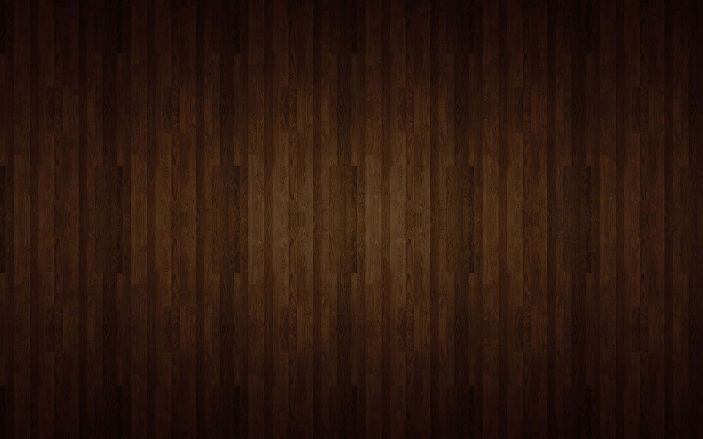
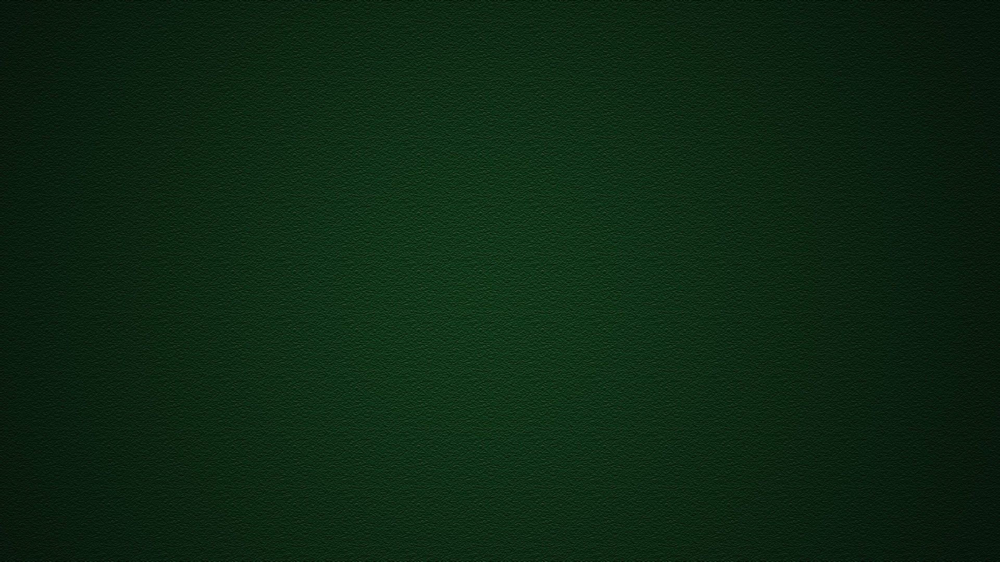
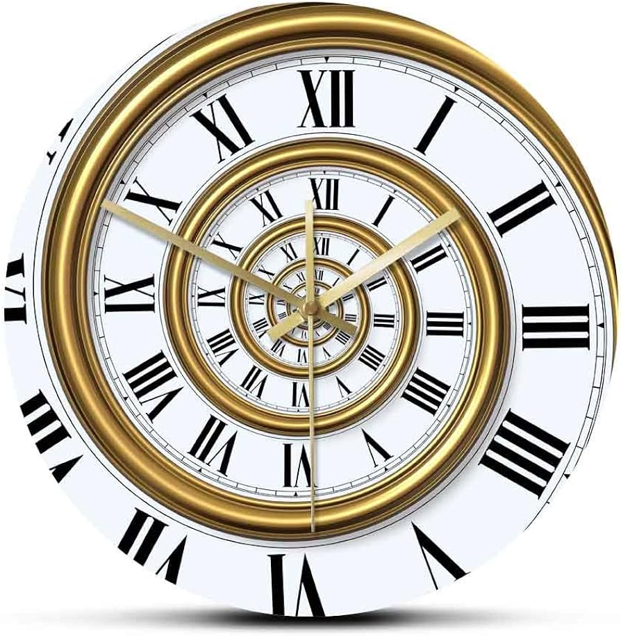

# 🌀 Impossible Staircase – Maya Modeling & Animation Project

A stylised **“impossible staircase” crystal snow globe** scene inspired by M. C. Escher’s *Ascending and Descending*, the Penrose Steps illusion (*Inception*), and London’s Big Ben, wrapped in a festive mood (tree, snow, ornaments).  
This project demonstrates **clean topology, procedural / iterative modeling, Arnold shading, MASH instanced snow dynamics, turntable presentation, and composition for portfolio rendering**.

---

## ✨ Preview

| Beauty / Glass | Tree / Base Texture | Clock Face |
|----------------|---------------------|------------|
|  |  |  |

### 🎥 Turntable

<video src="exports/turntable.mp4" width="480" loop muted playsinline controls></video>


---

## 🎯 Project Goals

- Convey a paradoxical “endless” staircase illusion inside a snow globe.
- Showcase production‑friendly topology & readable UV-ready geometry.
- Use **MASH + Bullet + Turbulence** for lightweight procedural snow motion.
- Present clear look‑dev through beauty, material, and structural views.
- Practice composition (rule‑of‑thirds focal energy) & soft studio lighting.

---

## 🔧 Technical Breakdown

| Aspect | Details )
|
|--------|--------------------------------|
| Software | Autodesk Maya (Version: / 2024** ) |
| Renderer | Arnold |
| Scene File | `scenes/impossible_staircase_final.mb` |
| Turntable Frames | 240 @ 24 fps (10 s) |
| Output Resolution | 1920 × 1080 (MP4 optimized: 960 × 540 preview) |
| FX | MASH instancing + Bullet dynamics + Turbulence field |
| Shaders | aiStandardSurface (glass, metals, painted surfaces), lambert (base), texture maps |
| Lighting | aiSkyDomeLight (environment), aiAreaLight(s)  |
| Composition | Rule‑of‑thirds focal placement / depth layering |
| Deliverables | Beauty, texture previews, turntable video, process PDF |

---

## 🧱 Modeling Workflow

1. **Blockout** – Primitive cubes iterated into Penrose‑like stair loop.  
2. **Refinement** – Added support edges, chamfers for subdivision‑friendly curvature.  
3. **Clock Element** – Planar UV + texture placement for Big Ben face motif.  
4. **Assembly** – Integrated tree, base, spheres (bounce actors) inside glass volume.  
5. **Topology Polish** – Ensured quad dominance, removed hidden / redundant geo.  

---

## ❄ Snow System (MASH)

| Step | Action |
|------|--------|
| 1 | Create single snowflake mesh asset. |
| 2 | Build **MASH Network** to scatter inside globe bounds. |
| 3 | Enable **MASH Dynamics (Bullet)** for basic collision / gravity interplay. |
| 4 | Add **Turbulence Field** → subtle drifting randomness. |
| 5 | Tune drag, amplitude, distribution → floating, non-chaotic motion. |

---

## 🧪 Glass Shader (Arnold Example Snippet)

```python
# aiStandardSurface glass-like parameters
cmds.setAttr(f"{shader}.base", 0)
cmds.setAttr(f"{shader}.specular.weight", 1)
cmds.setAttr(f"{shader}.specular.roughness", 0)
cmds.setAttr(f"{shader}.specular.IOR", 1.5)
cmds.setAttr(f"{shader}.transmission.weight", 1)
cmds.setAttr(f"{shader}.transmission.IOR", 1.5)
cmds.setAttr(f"{shader}.transmission.color", 1, 1, 1, type="double3")

```
## 🎨 Composition

**Focal Flow**  
Stair apex + main bounce arc aligned near rule‑of‑thirds hotspots for immediate visual draw.

**Layering**  
Glass shell (reflection) → internal staircase volume → drifting snow → clock face accent builds depth.

**Contrast**  
Specular transparent glass against matte/less reflective architectural surfaces improves silhouette readability.

**Color Accents**  
Restrained festive greens and reds punctuate neutral tones, guiding attention without distraction.

## 🧠 Reflection / Future Improvements

| Area | Next Step |
|------|-----------|
| Materials | Add micro‑roughness / variation maps for extra realism |
| Animation | Refine squash & stretch timing; introduce subtle secondary motion |
| FX | Add very light interior volumetric / thin god ray for depth |
| Proceduralism | Script parameterised staircase generator (step count, curvature) |
| Texturing | Substance pass for edge wear, dirt breakup, slight color variation |
| Presentation | Add wireframe overlay & UV layout sheet renders |

## 🚀 How to Use / View

1. Open `scenes/impossible_staircase_final.mb` in Maya (matching version or later).  
2. Play the timeline (ensure **MASH** plugins are loaded) to preview bounce + snow dynamics.  
3. Render the turntable with Arnold (swap / adjust HDRI if desired).  
4. View quick results: `exports/turntable.mp4` or `assets/turntable.gif`.  
5. Read `docs/design_process.pdf` for detailed process notes.  


## 📚 References & Inspiration

- Cheng, J.-H. *et al.* (2021). *Impossible Staircase: Vertically Real Walking in an Infinite Virtual Tower.* IEEE VR.  
- Wikipedia Contributors (2021). *Ascending and Descending.* https://en.wikipedia.org/wiki/Ascending_and_Descending  
- Penrose / Escher illusion concepts – educational reinterpretation.  
- Big Ben photographic references (public / study use).  

> Reference images are used strictly for **educational look‑dev purposes** and not for commercial redistribution.

## 👤 Author

**Flora Xohrat**  
MSc Computer Animation & VFX – Bournemouth University  
GitHub: [Flora9822](https://github.com/Flora9822)  

*Academic modeling & presentation exercise exploring illusion architecture, procedural instancing, and cinematic look‑dev.*
